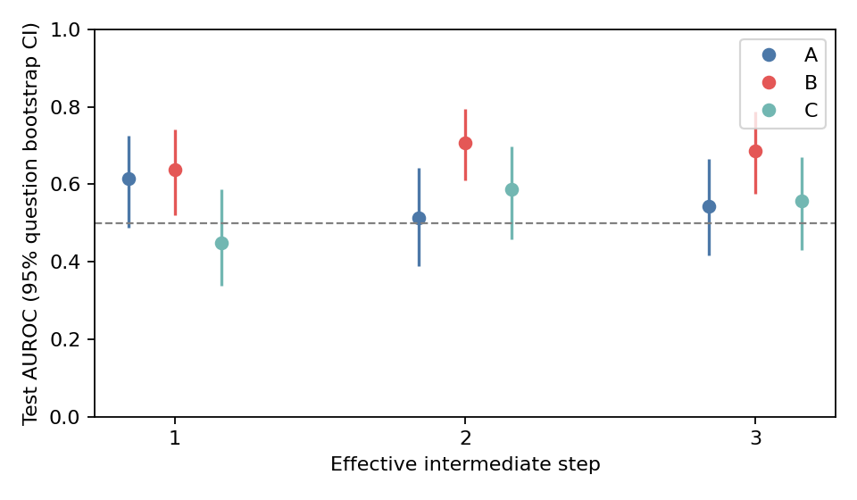

# 第二阶段：逐步 hidden 最终答错风险探针

原生 Thinking 内的真实双换行定义候选检查点，不保证每段是完整数学推理单元。
step_1/2/3 等历史字段在本 run 中表示第 1/2/3 个有效检查点；HIGH/LOW 是离线参考位置诊断。
格式示例固定在配置中（0 个简单问答），不来自实验题集；stage2/stage3 输入一致。
最终响应允许解释，仅评分末尾唯一且完整的 Final answer boxed 行；Thinking 内引用不参与评分。

运行：`v2-20261013-e136a41fea81`；报告更新于 2026-10-17T14:15:11.096549+08:00。

标签是完整轨迹最终答错（1）或答对（0）。主指标仅用于完成且可评分轨迹的正常中途检查点；不是局部错误标签。

模型 `Qwen/Qwen3.5-4B`，revision `851bf6e806efd8d0a36b00ddf55e13ccb7b8cd0a`；tokenizer `851bf6e806efd8d0a36b00ddf55e13ccb7b8cd0a`。
数据 `KbsdJames/omni-math-rule` / rule，revision `bda09972374225ab2186582615307d909965b864`。

这是采用逐步训练、题目权重、固定双换行检查点和独立测试的适配实验，不宣称完全复现论文。
原生 Thinking；采样与逐题种子见记录；新 token 81920，总上下文 131072。
按题去重后排序、固定种子划分：{'smoke': 10, 'test': 200, 'train': 100, 'verifier_audit': 20, 'verifier_dev': 20}；数据完整性见 dataset_integrity.json。
hidden_states[1..L] 排除 embedding；实际层数、维度和末层 final norm 约定见模型检查。
presence penalty 对生成与反馈后缀的每个已见 token 施加一次，不作用于题目 prompt。
探索实验；旧结果只作历史参照，不能将差异归因于单一变化。


特征逐个端点重前向其原始 token 前缀，保持 BF16 / SDPA / use_cache=False。
逐前缀提取另与独立 decoder 的最后位置比较，并检验同长度未来替换及错一 token 的负对照；容差未扩大。

## 实际环境

```json
{
  "bf16_sdpa_forward": true,
  "bf16_supported": true,
  "cuda_available": true,
  "cuda_build": "12.8",
  "executable": "/root/project/VeriServe-step-hidden-probe/environments/qwen35/.venv/bin/python",
  "free_total_bytes": [
    40276787200,
    50866487296
  ],
  "nvidia_smi": "NVIDIA GeForce RTX 4090, 49140 MiB, 38897 MiB, 595.58.03",
  "platform": "Linux-5.15.0-78-generic-x86_64-with-glibc2.35",
  "python": "3.12.3",
  "versions": {
    "antlr4-python3-runtime": "4.13.2",
    "datasets": "4.8.5",
    "huggingface-hub": "1.33.0",
    "latex2sympy2-extended": "1.11.0",
    "math-verify": "0.9.0",
    "matplotlib": "3.10.5",
    "numpy": "2.3.2",
    "scikit-learn": "1.9.1",
    "torch": "2.8.0+cu128",
    "transformers": "5.19.0"
  }
}
```

## 采集与排除

```json
{
  "train": {
    "generated": 100,
    "completed": 96,
    "correct": 75,
    "wrong": 19,
    "truncated": 4,
    "unscorable": 6,
    "no_steps": 0,
    "format_error_trajectories": 0,
    "features_missing_or_corrupt": 0,
    "planned": 100,
    "NO_FINAL_ANSWER": 2,
    "LENGTH_TRUNCATED": 4,
    "analyzable_end": 94,
    "analyzable_intermediate": 94,
    "normal_completion_rate": 0.96,
    "scorable_rate": 0.94,
    "correct_submission_rate": 0.75,
    "mathematical_accuracy_scorable": 0.7978723404255319
  },
  "test": {
    "generated": 200,
    "completed": 181,
    "correct": 149,
    "wrong": 28,
    "truncated": 19,
    "unscorable": 23,
    "no_steps": 0,
    "format_error_trajectories": 0,
    "features_missing_or_corrupt": 0,
    "planned": 200,
    "LENGTH_TRUNCATED": 19,
    "GOLD_UNPARSEABLE": 1,
    "FINAL_FORMAT_ERROR": 1,
    "THINKING_FORMAT_ERROR": 1,
    "PREDICTION_UNPARSEABLE": 1,
    "analyzable_end": 177,
    "analyzable_intermediate": 177,
    "normal_completion_rate": 0.905,
    "scorable_rate": 0.885,
    "correct_submission_rate": 0.745,
    "mathematical_accuracy_scorable": 0.8418079096045198
  }
}
```

## 自检与备份

```json
{
  "cpu_self_check": {
    "checked_at": "2026-10-15T04:59:22.692596+00:00",
    "checks": [
      "grade \\frac{1}{2} vs 0.5",
      "grade \\sqrt{8} vs 2\\sqrt{2}",
      "grade x+x vs 2x",
      "grade 2 vs 3",
      "missing boxed",
      "incomplete boxed",
      "last complete nested box",
      "only final line graded",
      "truncation excluded",
      "post-final text excluded",
      "cross-boundary token aligned backward",
      "second-step original token index",
      "answer step excluded",
      "last content token before EOS",
      "near-end retained",
      "anomalous numbering not guessed",
      "incomplete Unicode endpoint excluded",
      "mixed final content and newline token retained",
      "completed Unicode endpoint ∛",
      "completed Unicode endpoint 𝑥",
      "completed Unicode endpoint ∞",
      "completed Unicode endpoint 汉",
      "completed Unicode endpoint 🧮",
      "each question total weight one",
      "weighted scaler",
      "A/B/C fitting and grouped CV",
      "layer tie chooses smaller index",
      "weighted evaluation and paired bootstrap",
      "single-class bootstrap reports NA",
      "resume skips complete JSON and NPZ without generation",
      "damaged NPZ detected",
      "unrecoverable JSON never triggers regeneration",
      "valid JSON with invalid structure is preserved and rejected",
      "no-step causal check is not a failure"
    ],
    "environment": {
      "executable": "/root/project/VeriServe-step-hidden-probe/environments/qwen35/.venv/bin/python",
      "platform": "Linux-5.15.0-78-generic-x86_64-with-glibc2.35",
      "python": "3.12.3",
      "versions": {
        "antlr4-python3-runtime": "4.13.2",
        "datasets": "4.8.5",
        "huggingface-hub": "1.33.0",
        "latex2sympy2-extended": "1.11.0",
        "math-verify": "0.9.0",
        "matplotlib": "3.10.5",
        "numpy": "2.3.2",
        "scikit-learn": "1.9.1",
        "torch": "2.8.0+cu128",
        "transformers": "5.19.0"
      }
    },
    "note": "Synthetic CPU checks only; actual model causal/GPU and remote LFS checks belong to smoke",
    "passed": true,
    "script_sha256": "12ad7226934aa5883a1f6edd17673c7d79c58decd7477fbc9919638f022f47af"
  },
  "additional_implementation_checks": {
    "checked_at": "2026-10-04T12:33:07.087305+00:00",
    "layer_index_and_final_output": true,
    "note": "Implementation checks on a tiny randomly initialized Qwen2 decoder, not the requested 7B model; no experimental trajectories.",
    "pinned_tokenizer_alignment": [
      {
        "boundary_alignment": true,
        "effective_steps": 2,
        "excluded_steps": 0,
        "tokens": 29
      },
      {
        "boundary_alignment": true,
        "effective_steps": 1,
        "excluded_steps": 1,
        "tokens": 42
      }
    ],
    "script_sha256": "866da90db05d1d5467e16b2834b7fb6ff03fdfc63872a65caa0aad0f8081f745",
    "tiny_qwen_bf16_sdpa_causal": {
      "atol": 0.03125,
      "changed_future": {
        "max_abs": 0.0,
        "max_abs_per_layer": [
          0.0,
          0.0
        ],
        "passed": true,
        "rms": 0.0
      },
      "independent_prefix": {
        "max_abs": 0.0,
        "max_abs_per_layer": [
          0.0,
          0.0
        ],
        "passed": true,
        "rms": 0.0
      },
      "passed": true,
      "position": 5,
      "rtol": 0.008,
      "tolerance_note": "BF16 rounding: atol=1/32, rtol=one BF16 relative ULP; report raw errors"
    }
  },
  "smoke": {
    "completed_parseable_questions": 8,
    "not_applicable": 0,
    "passed": true,
    "questions": {
      "0f23a157f9d1cbb480ba0278fd79965960a66696d265382d736cc9894730f2d2": {
        "applicable": true,
        "atol": 0.03125,
        "changed_future": {
          "max_abs": 0.0,
          "max_abs_per_layer": [
            0.0,
            0.0,
            0.0,
            0.0,
            0.0,
            0.0,
            0.0,
            0.0,
            0.0,
            0.0,
            0.0,
            0.0,
            0.0,
            0.0,
            0.0,
            0.0,
            0.0,
            0.0,
            0.0,
            0.0,
            0.0,
            0.0,
            0.0,
            0.0,
            0.0,
            0.0,
            0.0,
            0.0,
            0.0,
            0.0,
            0.0,
            0.0
          ],
          "passed": true,
          "rms": 0.0
        },
        "completed_parseable": false,
        "completion": "LENGTH_TRUNCATED",
        "exclusion": "LENGTH_TRUNCATED",
        "extraction": "independent_original_prefixes",
        "independent_prefix": {
          "max_abs": 0.0,
          "max_abs_per_layer": [
            0.0,
            0.0,
            0.0,
            0.0,
            0.0,
            0.0,
            0.0,
            0.0,
            0.0,
            0.0,
            0.0,
            0.0,
            0.0,
            0.0,
            0.0,
            0.0,
            0.0,
            0.0,
            0.0,
            0.0,
            0.0,
            0.0,
            0.0,
            0.0,
            0.0,
            0.0,
            0.0,
            0.0,
            0.0,
            0.0,
            0.0,
            0.0
          ],
          "passed": true,
          "rms": 0.0
        },
        "passed": true,
        "position": 366,
        "previous_token_negative_control": {
          "detected": true,
          "max_abs": 38.53125,
          "max_abs_per_layer": [
            0.6484375,
            0.921875,
            0.3818359375,
            0.703125,
            1.046875,
            0.9833984375,
            1.123046875,
            1.23828125,
            1.3115234375,
            1.36865234375,
            1.421875,
            1.612548828125,
            1.86328125,
            2.06640625,
            2.386962890625,
            2.80078125,
            3.35546875,
            3.6865234375,
            3.859375,
            4.3876953125,
            4.6630859375,
            4.9365234375,
            5.189453125,
            5.4150390625,
            5.5,
            5.857421875,
            22.0,
            7.0283203125,
            8.0859375,
            8.2734375,
            7.9638671875,
            38.53125
          ],
          "passed": false,
          "rms": 0.8129584193229675
        },
        "rtol": 0.008,
        "scorable": false,
        "single_full_changed_future": {
          "max_abs": 0.0,
          "max_abs_per_layer": [
            0.0,
            0.0,
            0.0,
            0.0,
            0.0,
            0.0,
            0.0,
            0.0,
            0.0,
            0.0,
            0.0,
            0.0,
            0.0,
            0.0,
            0.0,
            0.0,
            0.0,
            0.0,
            0.0,
            0.0,
            0.0,
            0.0,
            0.0,
            0.0,
            0.0,
            0.0,
            0.0,
            0.0,
            0.0,
            0.0,
            0.0,
            0.0
          ],
          "passed": true,
          "rms": 0.0
        },
        "single_full_vs_prefix_diagnostic": {
          "gating": false,
          "max_abs": 0.25,
          "max_abs_per_layer": [
            0.0078125,
            0.015625,
            0.03125,
            0.03125,
            0.015625,
            0.00390625,
            0.00390625,
            0.0048828125,
            0.03125,
            0.03125,
            0.0048828125,
            0.03125,
            0.0078125,
            0.0078125,
            0.03125,
            0.03125,
            0.03125,
            0.03125,
            0.046875,
            0.0625,
            0.0625,
            0.0625,
            0.0625,
            0.0625,
            0.125,
            0.0625,
            0.25,
            0.125,
            0.25,
            0.25,
            0.25,
            0.25
          ],
          "note": "Retained full-once BF16 shape discrepancy; features use independent original prefixes",
          "passed": false,
          "rms": 0.010396678932011127,
          "used_for_features": false
        },
        "tolerance_note": "BF16 rounding: atol=1/32, rtol=one BF16 relative ULP; report raw errors"
      },
      "30908b6528753e36eb83667e2184bc75fd93134d44dca8f3d2a2079342ae822c": {
        "applicable": true,
        "atol": 0.03125,
        "changed_future": {
          "max_abs": 0.0,
          "max_abs_per_layer": [
            0.0,
            0.0,
            0.0,
            0.0,
            0.0,
            0.0,
            0.0,
            0.0,
            0.0,
            0.0,
            0.0,
            0.0,
            0.0,
            0.0,
            0.0,
            0.0,
            0.0,
            0.0,
            0.0,
            0.0,
            0.0,
            0.0,
            0.0,
            0.0,
            0.0,
            0.0,
            0.0,
            0.0,
            0.0,
            0.0,
            0.0,
            0.0
          ],
          "passed": true,
          "rms": 0.0
        },
        "completed_parseable": true,
        "completion": "EOS",
        "exclusion": null,
        "extraction": "independent_original_prefixes",
        "independent_prefix": {
          "max_abs": 0.0,
          "max_abs_per_layer": [
            0.0,
            0.0,
            0.0,
            0.0,
            0.0,
            0.0,
            0.0,
            0.0,
            0.0,
            0.0,
            0.0,
            0.0,
            0.0,
            0.0,
            0.0,
            0.0,
            0.0,
            0.0,
            0.0,
            0.0,
            0.0,
            0.0,
            0.0,
            0.0,
            0.0,
            0.0,
            0.0,
            0.0,
            0.0,
            0.0,
            0.0,
            0.0
          ],
          "passed": true,
          "rms": 0.0
        },
        "passed": true,
        "position": 219,
        "previous_token_negative_control": {
          "detected": true,
          "max_abs": 17.9375,
          "max_abs_per_layer": [
            0.453125,
            0.625,
            0.347900390625,
            0.481201171875,
            0.60205078125,
            0.7373046875,
            0.76171875,
            0.73486328125,
            0.802734375,
            0.8076171875,
            0.876953125,
            1.041015625,
            1.0625,
            1.169921875,
            1.34765625,
            1.64453125,
            1.734375,
            1.75,
            1.890625,
            2.34375,
            2.71875,
            3.3046875,
            3.7421875,
            3.5625,
            3.921875,
            4.3984375,
            8.1875,
            4.84375,
            5.5,
            7.5,
            6.625,
            17.9375
          ],
          "passed": false,
          "rms": 0.6551942825317383
        },
        "rtol": 0.008,
        "scorable": true,
        "single_full_changed_future": {
          "max_abs": 0.0,
          "max_abs_per_layer": [
            0.0,
            0.0,
            0.0,
            0.0,
            0.0,
            0.0,
            0.0,
            0.0,
            0.0,
            0.0,
            0.0,
            0.0,
            0.0,
            0.0,
            0.0,
            0.0,
            0.0,
            0.0,
            0.0,
            0.0,
            0.0,
            0.0,
            0.0,
            0.0,
            0.0,
            0.0,
            0.0,
            0.0,
            0.0,
            0.0,
            0.0,
            0.0
          ],
          "passed": true,
          "rms": 0.0
        },
        "single_full_vs_prefix_diagnostic": {
          "gating": false,
          "max_abs": 0.3125,
          "max_abs_per_layer": [
            0.00048828125,
            0.0009765625,
            0.001953125,
            0.001953125,
            0.00390625,
            0.015625,
            0.00390625,
            0.03125,
            0.0625,
            0.03125,
            0.0078125,
            0.03125,
            0.03125,
            0.03125,
            0.03125,
            0.03125,
            0.015625,
            0.015625,
            0.015625,
            0.015625,
            0.0234375,
            0.03125,
            0.03125,
            0.0625,
            0.0625,
            0.0625,
            0.0390625,
            0.125,
            0.125,
            0.125,
            0.0625,
            0.3125
          ],
          "note": "Retained full-once BF16 shape discrepancy; features use independent original prefixes",
          "passed": false,
          "rms": 0.007844802923500538,
          "used_for_features": false
        },
        "tolerance_note": "BF16 rounding: atol=1/32, rtol=one BF16 relative ULP; report raw errors"
      },
      "6113b9f050d676a6858e5fd2c7c96c21aadc51890244efebd6415024d2358355": {
        "applicable": true,
        "atol": 0.03125,
        "changed_future": {
          "max_abs": 0.0,
          "max_abs_per_layer": [
            0.0,
            0.0,
            0.0,
            0.0,
            0.0,
            0.0,
            0.0,
            0.0,
            0.0,
            0.0,
            0.0,
            0.0,
            0.0,
            0.0,
            0.0,
            0.0,
            0.0,
            0.0,
            0.0,
            0.0,
            0.0,
            0.0,
            0.0,
            0.0,
            0.0,
            0.0,
            0.0,
            0.0,
            0.0,
            0.0,
            0.0,
            0.0
          ],
          "passed": true,
          "rms": 0.0
        },
        "completed_parseable": true,
        "completion": "EOS",
        "exclusion": null,
        "extraction": "independent_original_prefixes",
        "independent_prefix": {
          "max_abs": 0.0,
          "max_abs_per_layer": [
            0.0,
            0.0,
            0.0,
            0.0,
            0.0,
            0.0,
            0.0,
            0.0,
            0.0,
            0.0,
            0.0,
            0.0,
            0.0,
            0.0,
            0.0,
            0.0,
            0.0,
            0.0,
            0.0,
            0.0,
            0.0,
            0.0,
            0.0,
            0.0,
            0.0,
            0.0,
            0.0,
            0.0,
            0.0,
            0.0,
            0.0,
            0.0
          ],
          "passed": true,
          "rms": 0.0
        },
        "passed": true,
        "position": 165,
        "previous_token_negative_control": {
          "detected": true,
          "max_abs": 13.43359375,
          "max_abs_per_layer": [
            0.4140625,
            0.484375,
            0.453369140625,
            0.572265625,
            0.744140625,
            0.865234375,
            0.9326171875,
            1.03515625,
            1.091796875,
            1.3125,
            1.181640625,
            1.2705078125,
            1.46435546875,
            1.572265625,
            1.809814453125,
            2.05859375,
            2.2578125,
            2.4296875,
            2.541015625,
            2.85546875,
            3.03125,
            3.3203125,
            3.517578125,
            3.765625,
            3.84375,
            3.9140625,
            5.34375,
            4.3203125,
            4.9453125,
            5.978515625,
            6.072265625,
            13.43359375
          ],
          "passed": false,
          "rms": 0.7006528973579407
        },
        "rtol": 0.008,
        "scorable": true,
        "single_full_changed_future": {
          "max_abs": 0.0,
          "max_abs_per_layer": [
            0.0,
            0.0,
            0.0,
            0.0,
            0.0,
            0.0,
            0.0,
            0.0,
            0.0,
            0.0,
            0.0,
            0.0,
            0.0,
            0.0,
            0.0,
            0.0,
            0.0,
            0.0,
            0.0,
            0.0,
            0.0,
            0.0,
            0.0,
            0.0,
            0.0,
            0.0,
            0.0,
            0.0,
            0.0,
            0.0,
            0.0,
            0.0
          ],
          "passed": true,
          "rms": 0.0
        },
        "single_full_vs_prefix_diagnostic": {
          "gating": false,
          "max_abs": 0.25,
          "max_abs_per_layer": [
            0.00048828125,
            0.001953125,
            0.015625,
            0.015625,
            0.00390625,
            0.015625,
            0.0078125,
            0.015625,
            0.03125,
            0.03125,
            0.0087890625,
            0.0087890625,
            0.015625,
            0.015625,
            0.015625,
            0.03125,
            0.03125,
            0.03125,
            0.015625,
            0.015625,
            0.03125,
            0.03125,
            0.0625,
            0.03125,
            0.09375,
            0.125,
            0.1875,
            0.1875,
            0.125,
            0.0625,
            0.125,
            0.25
          ],
          "note": "Retained full-once BF16 shape discrepancy; features use independent original prefixes",
          "passed": false,
          "rms": 0.008899568580091,
          "used_for_features": false
        },
        "tolerance_note": "BF16 rounding: atol=1/32, rtol=one BF16 relative ULP; report raw errors"
      },
      "66e9762e872ce0fd44499350967561202d4c7450fb2762d8d4fbee382e857432": {
        "applicable": true,
        "atol": 0.03125,
        "changed_future": {
          "max_abs": 0.0,
          "max_abs_per_layer": [
            0.0,
            0.0,
            0.0,
            0.0,
            0.0,
            0.0,
            0.0,
            0.0,
            0.0,
            0.0,
            0.0,
            0.0,
            0.0,
            0.0,
            0.0,
            0.0,
            0.0,
            0.0,
            0.0,
            0.0,
            0.0,
            0.0,
            0.0,
            0.0,
            0.0,
            0.0,
            0.0,
            0.0,
            0.0,
            0.0,
            0.0,
            0.0
          ],
          "passed": true,
          "rms": 0.0
        },
        "completed_parseable": true,
        "completion": "EOS",
        "exclusion": null,
        "extraction": "independent_original_prefixes",
        "independent_prefix": {
          "max_abs": 0.0,
          "max_abs_per_layer": [
            0.0,
            0.0,
            0.0,
            0.0,
            0.0,
            0.0,
            0.0,
            0.0,
            0.0,
            0.0,
            0.0,
            0.0,
            0.0,
            0.0,
            0.0,
            0.0,
            0.0,
            0.0,
            0.0,
            0.0,
            0.0,
            0.0,
            0.0,
            0.0,
            0.0,
            0.0,
            0.0,
            0.0,
            0.0,
            0.0,
            0.0,
            0.0
          ],
          "passed": true,
          "rms": 0.0
        },
        "passed": true,
        "position": 300,
        "previous_token_negative_control": {
          "detected": true,
          "max_abs": 22.875,
          "max_abs_per_layer": [
            0.159912109375,
            0.296875,
            0.26611328125,
            0.4375,
            0.3798828125,
            0.537109375,
            0.759765625,
            0.8115234375,
            0.935546875,
            0.970703125,
            1.02734375,
            1.126953125,
            1.361328125,
            1.54296875,
            1.794921875,
            2.12109375,
            2.3515625,
            2.3515625,
            2.421875,
            3.1796875,
            3.67578125,
            3.91015625,
            6.171875,
            4.22265625,
            4.48046875,
            5.3125,
            15.25,
            5.21875,
            6.1796875,
            6.47265625,
            6.802734375,
            22.875
          ],
          "passed": false,
          "rms": 0.7725980281829834
        },
        "rtol": 0.008,
        "scorable": true,
        "single_full_changed_future": {
          "max_abs": 0.0,
          "max_abs_per_layer": [
            0.0,
            0.0,
            0.0,
            0.0,
            0.0,
            0.0,
            0.0,
            0.0,
            0.0,
            0.0,
            0.0,
            0.0,
            0.0,
            0.0,
            0.0,
            0.0,
            0.0,
            0.0,
            0.0,
            0.0,
            0.0,
            0.0,
            0.0,
            0.0,
            0.0,
            0.0,
            0.0,
            0.0,
            0.0,
            0.0,
            0.0,
            0.0
          ],
          "passed": true,
          "rms": 0.0
        },
        "single_full_vs_prefix_diagnostic": {
          "gating": false,
          "max_abs": 0.25,
          "max_abs_per_layer": [
            0.00048828125,
            0.0009765625,
            0.0009765625,
            0.00390625,
            0.00390625,
            0.00390625,
            0.0029296875,
            0.03125,
            0.00390625,
            0.03125,
            0.03125,
            0.015625,
            0.015625,
            0.015625,
            0.015625,
            0.03125,
            0.0625,
            0.0625,
            0.09375,
            0.125,
            0.09375,
            0.09375,
            0.09375,
            0.09375,
            0.0625,
            0.0625,
            0.0625,
            0.125,
            0.09375,
            0.09375,
            0.125,
            0.25
          ],
          "note": "Retained full-once BF16 shape discrepancy; features use independent original prefixes",
          "passed": false,
          "rms": 0.012035042978823185,
          "used_for_features": false
        },
        "tolerance_note": "BF16 rounding: atol=1/32, rtol=one BF16 relative ULP; report raw errors"
      },
      "768eae894c4b077e6491275907b34520b257d7725b86b6364c24392f7dfe50c0": {
        "applicable": true,
        "atol": 0.03125,
        "changed_future": {
          "max_abs": 0.0,
          "max_abs_per_layer": [
            0.0,
            0.0,
            0.0,
            0.0,
            0.0,
            0.0,
            0.0,
            0.0,
            0.0,
            0.0,
            0.0,
            0.0,
            0.0,
            0.0,
            0.0,
            0.0,
            0.0,
            0.0,
            0.0,
            0.0,
            0.0,
            0.0,
            0.0,
            0.0,
            0.0,
            0.0,
            0.0,
            0.0,
            0.0,
            0.0,
            0.0,
            0.0
          ],
          "passed": true,
          "rms": 0.0
        },
        "completed_parseable": true,
        "completion": "EOS",
        "exclusion": null,
        "extraction": "independent_original_prefixes",
        "independent_prefix": {
          "max_abs": 0.0,
          "max_abs_per_layer": [
            0.0,
            0.0,
            0.0,
            0.0,
            0.0,
            0.0,
            0.0,
            0.0,
            0.0,
            0.0,
            0.0,
            0.0,
            0.0,
            0.0,
            0.0,
            0.0,
            0.0,
            0.0,
            0.0,
            0.0,
            0.0,
            0.0,
            0.0,
            0.0,
            0.0,
            0.0,
            0.0,
            0.0,
            0.0,
            0.0,
            0.0,
            0.0
          ],
          "passed": true,
          "rms": 0.0
        },
        "passed": true,
        "position": 225,
        "previous_token_negative_control": {
          "detected": true,
          "max_abs": 25.28515625,
          "max_abs_per_layer": [
            0.484375,
            0.53125,
            0.4556884765625,
            0.6005859375,
            0.69287109375,
            0.8779296875,
            0.9296875,
            1.0185546875,
            1.041015625,
            1.154541015625,
            1.1865234375,
            1.263671875,
            1.501953125,
            1.654296875,
            1.689453125,
            2.02734375,
            1.9609375,
            2.0703125,
            1.8828125,
            2.234375,
            2.390625,
            2.703125,
            5.25,
            3.390625,
            3.578125,
            4.6875,
            21.0625,
            3.875,
            4.65625,
            4.84375,
            8.453125,
            25.28515625
          ],
          "passed": false,
          "rms": 0.6758405566215515
        },
        "rtol": 0.008,
        "scorable": true,
        "single_full_changed_future": {
          "max_abs": 0.0,
          "max_abs_per_layer": [
            0.0,
            0.0,
            0.0,
            0.0,
            0.0,
            0.0,
            0.0,
            0.0,
            0.0,
            0.0,
            0.0,
            0.0,
            0.0,
            0.0,
            0.0,
            0.0,
            0.0,
            0.0,
            0.0,
            0.0,
            0.0,
            0.0,
            0.0,
            0.0,
            0.0,
            0.0,
            0.0,
            0.0,
            0.0,
            0.0,
            0.0,
            0.0
          ],
          "passed": true,
          "rms": 0.0
        },
        "single_full_vs_prefix_diagnostic": {
          "gating": false,
          "max_abs": 0.25,
          "max_abs_per_layer": [
            0.0009765625,
            0.001953125,
            0.001953125,
            0.015625,
            0.002197265625,
            0.03125,
            0.03125,
            0.03125,
            0.03125,
            0.0625,
            0.0625,
            0.09375,
            0.09375,
            0.0625,
            0.03125,
            0.0625,
            0.09375,
            0.0625,
            0.078125,
            0.0625,
            0.0625,
            0.0625,
            0.03125,
            0.0234375,
            0.03125,
            0.0625,
            0.03125,
            0.125,
            0.125,
            0.125,
            0.125,
            0.25
          ],
          "note": "Retained full-once BF16 shape discrepancy; features use independent original prefixes",
          "passed": false,
          "rms": 0.009505177848041058,
          "used_for_features": false
        },
        "tolerance_note": "BF16 rounding: atol=1/32, rtol=one BF16 relative ULP; report raw errors"
      },
      "8cbe0c48c29daa190277e30a3c53fe756b4e80c8aa78420c2a5ded9983d59d69": {
        "applicable": true,
        "atol": 0.03125,
        "changed_future": {
          "max_abs": 0.0,
          "max_abs_per_layer": [
            0.0,
            0.0,
            0.0,
            0.0,
            0.0,
            0.0,
            0.0,
            0.0,
            0.0,
            0.0,
            0.0,
            0.0,
            0.0,
            0.0,
            0.0,
            0.0,
            0.0,
            0.0,
            0.0,
            0.0,
            0.0,
            0.0,
            0.0,
            0.0,
            0.0,
            0.0,
            0.0,
            0.0,
            0.0,
            0.0,
            0.0,
            0.0
          ],
          "passed": true,
          "rms": 0.0
        },
        "completed_parseable": true,
        "completion": "EOS",
        "exclusion": null,
        "extraction": "independent_original_prefixes",
        "independent_prefix": {
          "max_abs": 0.0,
          "max_abs_per_layer": [
            0.0,
            0.0,
            0.0,
            0.0,
            0.0,
            0.0,
            0.0,
            0.0,
            0.0,
            0.0,
            0.0,
            0.0,
            0.0,
            0.0,
            0.0,
            0.0,
            0.0,
            0.0,
            0.0,
            0.0,
            0.0,
            0.0,
            0.0,
            0.0,
            0.0,
            0.0,
            0.0,
            0.0,
            0.0,
            0.0,
            0.0,
            0.0
          ],
          "passed": true,
          "rms": 0.0
        },
        "passed": true,
        "position": 217,
        "previous_token_negative_control": {
          "detected": true,
          "max_abs": 25.4375,
          "max_abs_per_layer": [
            0.65625,
            0.6484375,
            0.36328125,
            0.5712890625,
            0.83203125,
            0.935546875,
            1.091796875,
            1.59375,
            1.357421875,
            1.466796875,
            1.609375,
            1.6318359375,
            1.884521484375,
            2.049560546875,
            2.269775390625,
            2.58984375,
            2.9140625,
            3.2578125,
            3.35546875,
            4.25,
            4.61328125,
            4.85546875,
            5.32421875,
            5.7265625,
            5.875,
            6.05078125,
            17.375,
            6.7421875,
            7.6875,
            9.4375,
            8.0078125,
            25.4375
          ],
          "passed": false,
          "rms": 0.7003049850463867
        },
        "rtol": 0.008,
        "scorable": true,
        "single_full_changed_future": {
          "max_abs": 0.0,
          "max_abs_per_layer": [
            0.0,
            0.0,
            0.0,
            0.0,
            0.0,
            0.0,
            0.0,
            0.0,
            0.0,
            0.0,
            0.0,
            0.0,
            0.0,
            0.0,
            0.0,
            0.0,
            0.0,
            0.0,
            0.0,
            0.0,
            0.0,
            0.0,
            0.0,
            0.0,
            0.0,
            0.0,
            0.0,
            0.0,
            0.0,
            0.0,
            0.0,
            0.0
          ],
          "passed": true,
          "rms": 0.0
        },
        "single_full_vs_prefix_diagnostic": {
          "gating": false,
          "max_abs": 0.25,
          "max_abs_per_layer": [
            0.00048828125,
            0.00048828125,
            0.0078125,
            0.001953125,
            0.001953125,
            0.0029296875,
            0.00390625,
            0.00439453125,
            0.0048828125,
            0.00390625,
            0.005859375,
            0.0078125,
            0.0078125,
            0.0078125,
            0.0078125,
            0.0078125,
            0.009765625,
            0.0625,
            0.03125,
            0.03125,
            0.03125,
            0.03125,
            0.0625,
            0.03125,
            0.03125,
            0.0625,
            0.046875,
            0.0625,
            0.0625,
            0.0625,
            0.078125,
            0.25
          ],
          "note": "Retained full-once BF16 shape discrepancy; features use independent original prefixes",
          "passed": false,
          "rms": 0.009748303331434727,
          "used_for_features": false
        },
        "tolerance_note": "BF16 rounding: atol=1/32, rtol=one BF16 relative ULP; report raw errors"
      },
      "8d921bb20bae08d9cc071dea699a7fa358f8ceb4d5c04595b7ff7cfa4ea5e51d": {
        "applicable": true,
        "atol": 0.03125,
        "changed_future": {
          "max_abs": 0.0,
          "max_abs_per_layer": [
            0.0,
            0.0,
            0.0,
            0.0,
            0.0,
            0.0,
            0.0,
            0.0,
            0.0,
            0.0,
            0.0,
            0.0,
            0.0,
            0.0,
            0.0,
            0.0,
            0.0,
            0.0,
            0.0,
            0.0,
            0.0,
            0.0,
            0.0,
            0.0,
            0.0,
            0.0,
            0.0,
            0.0,
            0.0,
            0.0,
            0.0,
            0.0
          ],
          "passed": true,
          "rms": 0.0
        },
        "completed_parseable": true,
        "completion": "EOS",
        "exclusion": null,
        "extraction": "independent_original_prefixes",
        "independent_prefix": {
          "max_abs": 0.0,
          "max_abs_per_layer": [
            0.0,
            0.0,
            0.0,
            0.0,
            0.0,
            0.0,
            0.0,
            0.0,
            0.0,
            0.0,
            0.0,
            0.0,
            0.0,
            0.0,
            0.0,
            0.0,
            0.0,
            0.0,
            0.0,
            0.0,
            0.0,
            0.0,
            0.0,
            0.0,
            0.0,
            0.0,
            0.0,
            0.0,
            0.0,
            0.0,
            0.0,
            0.0
          ],
          "passed": true,
          "rms": 0.0
        },
        "passed": true,
        "position": 436,
        "previous_token_negative_control": {
          "detected": true,
          "max_abs": 39.875,
          "max_abs_per_layer": [
            0.5625,
            0.9140625,
            0.4443359375,
            0.76953125,
            0.890625,
            1.083984375,
            1.14453125,
            1.26953125,
            1.40234375,
            1.4453125,
            1.52734375,
            1.6790771484375,
            2.0693359375,
            2.3173828125,
            2.6865234375,
            3.236328125,
            4.07275390625,
            4.40576171875,
            4.755859375,
            6.1640625,
            6.673828125,
            7.01171875,
            7.818359375,
            7.890625,
            8.1953125,
            8.3125,
            8.96875,
            8.859375,
            9.2646484375,
            9.142578125,
            9.31640625,
            39.875
          ],
          "passed": false,
          "rms": 0.8233453035354614
        },
        "rtol": 0.008,
        "scorable": true,
        "single_full_changed_future": {
          "max_abs": 0.0,
          "max_abs_per_layer": [
            0.0,
            0.0,
            0.0,
            0.0,
            0.0,
            0.0,
            0.0,
            0.0,
            0.0,
            0.0,
            0.0,
            0.0,
            0.0,
            0.0,
            0.0,
            0.0,
            0.0,
            0.0,
            0.0,
            0.0,
            0.0,
            0.0,
            0.0,
            0.0,
            0.0,
            0.0,
            0.0,
            0.0,
            0.0,
            0.0,
            0.0,
            0.0
          ],
          "passed": true,
          "rms": 0.0
        },
        "single_full_vs_prefix_diagnostic": {
          "gating": false,
          "max_abs": 0.1875,
          "max_abs_per_layer": [
            0.0078125,
            0.0009765625,
            0.0078125,
            0.015625,
            0.00390625,
            0.00390625,
            0.00390625,
            0.00390625,
            0.00390625,
            0.00390625,
            0.0048828125,
            0.005859375,
            0.0078125,
            0.0078125,
            0.0078125,
            0.03125,
            0.015625,
            0.03125,
            0.046875,
            0.0625,
            0.0625,
            0.0625,
            0.0625,
            0.0625,
            0.0625,
            0.0625,
            0.09375,
            0.09375,
            0.125,
            0.0625,
            0.0625,
            0.1875
          ],
          "note": "Retained full-once BF16 shape discrepancy; features use independent original prefixes",
          "passed": false,
          "rms": 0.009321174584329128,
          "used_for_features": false
        },
        "tolerance_note": "BF16 rounding: atol=1/32, rtol=one BF16 relative ULP; report raw errors"
      },
      "b06dd6f0e8140ab15e5f660bc6712886b667213459eb3739c23eded89f8c459a": {
        "applicable": true,
        "atol": 0.03125,
        "changed_future": {
          "max_abs": 0.0,
          "max_abs_per_layer": [
            0.0,
            0.0,
            0.0,
            0.0,
            0.0,
            0.0,
            0.0,
            0.0,
            0.0,
            0.0,
            0.0,
            0.0,
            0.0,
            0.0,
            0.0,
            0.0,
            0.0,
            0.0,
            0.0,
            0.0,
            0.0,
            0.0,
            0.0,
            0.0,
            0.0,
            0.0,
            0.0,
            0.0,
            0.0,
            0.0,
            0.0,
            0.0
          ],
          "passed": true,
          "rms": 0.0
        },
        "completed_parseable": true,
        "completion": "EOS",
        "exclusion": null,
        "extraction": "independent_original_prefixes",
        "independent_prefix": {
          "max_abs": 0.0,
          "max_abs_per_layer": [
            0.0,
            0.0,
            0.0,
            0.0,
            0.0,
            0.0,
            0.0,
            0.0,
            0.0,
            0.0,
            0.0,
            0.0,
            0.0,
            0.0,
            0.0,
            0.0,
            0.0,
            0.0,
            0.0,
            0.0,
            0.0,
            0.0,
            0.0,
            0.0,
            0.0,
            0.0,
            0.0,
            0.0,
            0.0,
            0.0,
            0.0,
            0.0
          ],
          "passed": true,
          "rms": 0.0
        },
        "passed": true,
        "position": 180,
        "previous_token_negative_control": {
          "detected": true,
          "max_abs": 33.375,
          "max_abs_per_layer": [
            0.2421875,
            0.59375,
            0.362548828125,
            0.984375,
            1.015625,
            0.8046875,
            1.078125,
            1.07421875,
            1.1171875,
            1.287109375,
            1.46875,
            1.4013671875,
            1.494140625,
            1.580078125,
            1.58984375,
            1.708251953125,
            1.998046875,
            1.884765625,
            2.46875,
            1.47265625,
            1.6328125,
            2.6875,
            8.625,
            2.4765625,
            2.765625,
            3.02734375,
            33.375,
            3.15625,
            3.265625,
            4.0859375,
            4.68359375,
            17.375
          ],
          "passed": false,
          "rms": 0.812660813331604
        },
        "rtol": 0.008,
        "scorable": true,
        "single_full_changed_future": {
          "max_abs": 0.0,
          "max_abs_per_layer": [
            0.0,
            0.0,
            0.0,
            0.0,
            0.0,
            0.0,
            0.0,
            0.0,
            0.0,
            0.0,
            0.0,
            0.0,
            0.0,
            0.0,
            0.0,
            0.0,
            0.0,
            0.0,
            0.0,
            0.0,
            0.0,
            0.0,
            0.0,
            0.0,
            0.0,
            0.0,
            0.0,
            0.0,
            0.0,
            0.0,
            0.0,
            0.0
          ],
          "passed": true,
          "rms": 0.0
        },
        "single_full_vs_prefix_diagnostic": {
          "gating": false,
          "max_abs": 3.328125,
          "max_abs_per_layer": [
            0.00048828125,
            0.015625,
            0.0234375,
            0.015625,
            0.015625,
            0.015625,
            0.009765625,
            0.01171875,
            0.01171875,
            0.015625,
            0.015625,
            0.015625,
            0.015625,
            0.013671875,
            0.015625,
            0.013671875,
            0.03125,
            0.0625,
            0.0625,
            0.0625,
            0.0625,
            0.03125,
            0.0625,
            0.0625,
            0.046875,
            0.09375,
            0.25,
            0.25,
            0.25,
            0.3125,
            2.125,
            3.328125
          ],
          "note": "Retained full-once BF16 shape discrepancy; features use independent original prefixes",
          "passed": false,
          "rms": 0.08942768722772598,
          "used_for_features": false
        },
        "tolerance_note": "BF16 rounding: atol=1/32, rtol=one BF16 relative ULP; report raw errors"
      },
      "da479a3d912813cafd000d6da2242458f8d38e1ce9cb95bf0de0f3b01794aef3": {
        "applicable": true,
        "atol": 0.03125,
        "changed_future": {
          "max_abs": 0.0,
          "max_abs_per_layer": [
            0.0,
            0.0,
            0.0,
            0.0,
            0.0,
            0.0,
            0.0,
            0.0,
            0.0,
            0.0,
            0.0,
            0.0,
            0.0,
            0.0,
            0.0,
            0.0,
            0.0,
            0.0,
            0.0,
            0.0,
            0.0,
            0.0,
            0.0,
            0.0,
            0.0,
            0.0,
            0.0,
            0.0,
            0.0,
            0.0,
            0.0,
            0.0
          ],
          "passed": true,
          "rms": 0.0
        },
        "completed_parseable": false,
        "completion": "LENGTH_TRUNCATED",
        "exclusion": "LENGTH_TRUNCATED",
        "extraction": "independent_original_prefixes",
        "independent_prefix": {
          "max_abs": 0.0,
          "max_abs_per_layer": [
            0.0,
            0.0,
            0.0,
            0.0,
            0.0,
            0.0,
            0.0,
            0.0,
            0.0,
            0.0,
            0.0,
            0.0,
            0.0,
            0.0,
            0.0,
            0.0,
            0.0,
            0.0,
            0.0,
            0.0,
            0.0,
            0.0,
            0.0,
            0.0,
            0.0,
            0.0,
            0.0,
            0.0,
            0.0,
            0.0,
            0.0,
            0.0
          ],
          "passed": true,
          "rms": 0.0
        },
        "passed": true,
        "position": 194,
        "previous_token_negative_control": {
          "detected": true,
          "max_abs": 31.34765625,
          "max_abs_per_layer": [
            0.7890625,
            1.2890625,
            0.496826171875,
            0.859375,
            0.76708984375,
            0.9521484375,
            0.96337890625,
            1.03271484375,
            1.1064453125,
            1.18359375,
            1.233642578125,
            1.369140625,
            1.60546875,
            1.6484375,
            2.046875,
            2.52734375,
            2.9609375,
            3.34375,
            3.484375,
            4.28125,
            4.69140625,
            4.859375,
            6.375,
            6.0927734375,
            6.4130859375,
            6.177734375,
            27.25,
            7.130859375,
            7.71044921875,
            8.29248046875,
            8.8203125,
            31.34765625
          ],
          "passed": false,
          "rms": 0.825959324836731
        },
        "rtol": 0.008,
        "scorable": false,
        "single_full_changed_future": {
          "max_abs": 0.0,
          "max_abs_per_layer": [
            0.0,
            0.0,
            0.0,
            0.0,
            0.0,
            0.0,
            0.0,
            0.0,
            0.0,
            0.0,
            0.0,
            0.0,
            0.0,
            0.0,
            0.0,
            0.0,
            0.0,
            0.0,
            0.0,
            0.0,
            0.0,
            0.0,
            0.0,
            0.0,
            0.0,
            0.0,
            0.0,
            0.0,
            0.0,
            0.0,
            0.0,
            0.0
          ],
          "passed": true,
          "rms": 0.0
        },
        "single_full_vs_prefix_diagnostic": {
          "gating": false,
          "max_abs": 0.25,
          "max_abs_per_layer": [
            0.0078125,
            0.0078125,
            0.001953125,
            0.00390625,
            0.0078125,
            0.0078125,
            0.0078125,
            0.0078125,
            0.0078125,
            0.015625,
            0.015625,
            0.015625,
            0.0234375,
            0.03125,
            0.046875,
            0.046875,
            0.046875,
            0.046875,
            0.03125,
            0.03125,
            0.03125,
            0.03125,
            0.03125,
            0.03125,
            0.03125,
            0.0390625,
            0.25,
            0.1875,
            0.0625,
            0.0625,
            0.125,
            0.25
          ],
          "note": "Retained full-once BF16 shape discrepancy; features use independent original prefixes",
          "passed": false,
          "rms": 0.010280000045895576,
          "used_for_features": false
        },
        "tolerance_note": "BF16 rounding: atol=1/32, rtol=one BF16 relative ULP; report raw errors"
      },
      "df9af8a321516208b329d6aea7e7e313cda29ccc9e67811a8b20ac10ca2b1b46": {
        "applicable": true,
        "atol": 0.03125,
        "changed_future": {
          "max_abs": 0.0,
          "max_abs_per_layer": [
            0.0,
            0.0,
            0.0,
            0.0,
            0.0,
            0.0,
            0.0,
            0.0,
            0.0,
            0.0,
            0.0,
            0.0,
            0.0,
            0.0,
            0.0,
            0.0,
            0.0,
            0.0,
            0.0,
            0.0,
            0.0,
            0.0,
            0.0,
            0.0,
            0.0,
            0.0,
            0.0,
            0.0,
            0.0,
            0.0,
            0.0,
            0.0
          ],
          "passed": true,
          "rms": 0.0
        },
        "completed_parseable": true,
        "completion": "EOS",
        "exclusion": null,
        "extraction": "independent_original_prefixes",
        "independent_prefix": {
          "max_abs": 0.0,
          "max_abs_per_layer": [
            0.0,
            0.0,
            0.0,
            0.0,
            0.0,
            0.0,
            0.0,
            0.0,
            0.0,
            0.0,
            0.0,
            0.0,
            0.0,
            0.0,
            0.0,
            0.0,
            0.0,
            0.0,
            0.0,
            0.0,
            0.0,
            0.0,
            0.0,
            0.0,
            0.0,
            0.0,
            0.0,
            0.0,
            0.0,
            0.0,
            0.0,
            0.0
          ],
          "passed": true,
          "rms": 0.0
        },
        "passed": true,
        "position": 170,
        "previous_token_negative_control": {
          "detected": true,
          "max_abs": 31.25,
          "max_abs_per_layer": [
            0.1875,
            0.375,
            0.41943359375,
            0.6416015625,
            0.794189453125,
            0.93359375,
            0.97265625,
            1.0380859375,
            1.08984375,
            1.218994140625,
            1.33642578125,
            1.419921875,
            1.63671875,
            1.8203125,
            1.94140625,
            2.265625,
            2.2890625,
            2.3671875,
            2.5625,
            2.734375,
            3.328125,
            3.7890625,
            9.375,
            4.4375,
            4.6875,
            6.5625,
            31.25,
            5.171875,
            5.625,
            6.265625,
            6.9375,
            22.625
          ],
          "passed": false,
          "rms": 0.7033262848854065
        },
        "rtol": 0.008,
        "scorable": true,
        "single_full_changed_future": {
          "max_abs": 0.0,
          "max_abs_per_layer": [
            0.0,
            0.0,
            0.0,
            0.0,
            0.0,
            0.0,
            0.0,
            0.0,
            0.0,
            0.0,
            0.0,
            0.0,
            0.0,
            0.0,
            0.0,
            0.0,
            0.0,
            0.0,
            0.0,
            0.0,
            0.0,
            0.0,
            0.0,
            0.0,
            0.0,
            0.0,
            0.0,
            0.0,
            0.0,
            0.0,
            0.0,
            0.0
          ],
          "passed": true,
          "rms": 0.0
        },
        "single_full_vs_prefix_diagnostic": {
          "gating": false,
          "max_abs": 0.25,
          "max_abs_per_layer": [
            0.000244140625,
            0.00048828125,
            0.001953125,
            0.015625,
            0.03125,
            0.046875,
            0.03125,
            0.0078125,
            0.03125,
            0.03125,
            0.0078125,
            0.0078125,
            0.03125,
            0.03125,
            0.03125,
            0.03125,
            0.03125,
            0.03125,
            0.03125,
            0.03125,
            0.03125,
            0.03125,
            0.03125,
            0.03125,
            0.03125,
            0.125,
            0.25,
            0.0625,
            0.125,
            0.125,
            0.125,
            0.25
          ],
          "note": "Retained full-once BF16 shape discrepancy; features use independent original prefixes",
          "passed": false,
          "rms": 0.010291118174791336,
          "used_for_features": false
        },
        "tolerance_note": "BF16 rounding: atol=1/32, rtol=one BF16 relative ULP; report raw errors"
      }
    },
    "scorable_questions": 8,
    "source_code": {
      "common_sha256": "289a98ce0707d9383b573cf16a48da234a447ef51058f9e92ae7f021dc1c7c98",
      "execution_sources": {
        "stages/stage1/veriserve/__init__.py": "ff898c775de7edd0158af3d21a664a49bf21ef75b0bf0b9f7066b37ba4fd2665",
        "stages/stage1/veriserve/common.py": "289a98ce0707d9383b573cf16a48da234a447ef51058f9e92ae7f021dc1c7c98",
        "stages/stage1/veriserve/data.py": "599745356c71d74f1e96f8de5d9f1f5c30832534b740d61ab44624cdab3a0e4c",
        "stages/stage1/veriserve/model.py": "7dfd702e3be8f6143af9aad8503bfe322e22a70e52f0fa8075afbf8eeabaa5de",
        "stages/stage1/veriserve/prm.py": "df53e83e4d212076e38ec3ea4e8f6aa2fba50098a3dd2d433b4eb2e8c580e1f2",
        "stages/stage1/veriserve/state.py": "50b2ff717e956f4f4878e53b8e6e1fb9d155792fedb4d60738405c0ac7da3365",
        "veriserve_research/__init__.py": "b91a1030c85f6e57d2da048a5683b6456a2580e0d8ce724dec6d30ee4d42a650",
        "veriserve_research/__main__.py": "a4ba058e34feb88f1bb7be96ec23e0eac1dc879fa2a5251c27d974e2faf7a336",
        "veriserve_research/artifacts/__init__.py": "e3b0c44298fc1c149afbf4c8996fb92427ae41e4649b934ca495991b7852b855",
        "veriserve_research/artifacts/backup.py": "5220cefa8c1f08c619cce8827d8fa7e97ac3d6f6ddeeecd805cee4ebd4028533",
        "veriserve_research/artifacts/io.py": "fb70a9f59be25ab9a44c72d380f21897b6895e5c93204bc31516de135dc24acb",
        "veriserve_research/artifacts/legacy.py": "bc98eea48016ea6b70812df6a4f05c0b50981d0415486d654e4ceb66af0f549a",
        "veriserve_research/artifacts/materials.py": "94991c3f2e649b010ced6b6eeda492a35e55e304cf1c891f1289df821f214d0e",
        "veriserve_research/artifacts/provenance.py": "c82a9ecb28789a9e690bee5dd6d9576c7f6cc7be765d2d796ea8e1c9e38ef0e3",
        "veriserve_research/inference.py": "8bc9137d053c4b27c1765318050deeca25d7be5ce43daaa77318102dba2a6998",
        "veriserve_research/probe/__init__.py": "e3b0c44298fc1c149afbf4c8996fb92427ae41e4649b934ca495991b7852b855",
        "veriserve_research/probe/collect.py": "12ad7226934aa5883a1f6edd17673c7d79c58decd7477fbc9919638f022f47af",
        "veriserve_research/probe/fit.py": "0bfb79008b2178169ba8bdb2ab9cab9a29626bf0faa23a075ff0cdfee9e073ab",
        "veriserve_research/probe/materials.py": "3ba86c6aa63b8f8f5d5848a506027e0dc1e167bcc75c1b2162fb44b35a3991bb",
        "veriserve_research/trajectory.py": "d79b247284fb98488cbdc29fef19928d7443b492c1fd5e8d20d3b6c07c7f0358",
        "veriserve_research/vllm_backend.py": "228a47347116b2d030f08c3865d726800f0fa32c02571993277e39df1e057d74"
      },
      "script_sha256": "335994798ad6e0052d1388f254b1370892d9ee3413236f4f164ac2667214eca9"
    },
    "updated_at": "2026-10-15T04:58:58.401797+00:00"
  },
  "resume": {
    "checked_at": "2026-10-15T04:59:38.822965+00:00",
    "hashes_after_for_existing": {
      "records/smoke/0015809f6341a9656a0b.features-335994798ad6.npz": "d28d0b1190d52818d2db8624dc5837663e372e300fc1c82f85afcbd64461697c",
      "records/smoke/0015809f6341a9656a0b.json": "8e80010f3c5fc3e8e2e2d94793050480f2d5325bd758dd19c7228a0e58ad6b77",
      "records/smoke/29fb09aef2d2b8192e12.features-335994798ad6.npz": "1a6c6d6302f49a86eebd1c11699acd28b3d7ba65bbdfcbc5a3d37ce37c2fc957",
      "records/smoke/29fb09aef2d2b8192e12.json": "b06fe659c991c328273e22a1297d03447c988e5a7f49e9374867a6ee89376b63",
      "records/smoke/5bc5cc06c5ec1e5c60a2.features-335994798ad6.npz": "2cb2bdf11ab8416fb7fc5174158434230315961e55fc64e9b229ea346594a4b5",
      "records/smoke/5bc5cc06c5ec1e5c60a2.json": "105d2a7f5bbd59fe2d1d41dd4b71389dcc8a468844502dc1c81cc6192e3449fe",
      "records/smoke/722fbccd50c4dbcfee15.features-335994798ad6.npz": "818b676a88fec4603d9978b924dc9407d9db19af2c1dffdff71de05261741245",
      "records/smoke/722fbccd50c4dbcfee15.json": "63a64d5367ccaaafec24c1f651a68bdf2ac344610111622b7bd7a19da75e3830",
      "records/smoke/8fe8ba3e885ab91a95bb.features-335994798ad6.npz": "285dcfe847e1c4785c5b4ada84ea6d452e399d0b61ef5841f89e2c8b447952ca",
      "records/smoke/8fe8ba3e885ab91a95bb.json": "5988c8f4789af95689821ce1e4abfaa672acd9ef74d5eb21af3a983fb1a5433d",
      "records/smoke/9ccccfe8203576afba40.features-335994798ad6.npz": "c7e6bdda73f5714a7bd7ec22beade767705cac7331c5d7911b7007f2e58b566d",
      "records/smoke/9ccccfe8203576afba40.json": "d3922cd39211c666c2de4735195631c4d0e06eea8087a39ccba5e1b2c8653441",
      "records/smoke/d3d76e355f0a3a408887.features-335994798ad6.layers1-22.npz": "b47afbeb64e4319af82617bc5a4c5f4b1619522eee448d6db50864c0b125bc4f",
      "records/smoke/d3d76e355f0a3a408887.features-335994798ad6.layers23-32.npz": "092169dd2b4ccdf191826aa0671a8bc2970d11627f5cf4961488fea390cab8fa",
      "records/smoke/d3d76e355f0a3a408887.json": "27b3602f21a682f16ca02ce335647d37aee44aeb43a060abc28360e657f6b9cc",
      "records/smoke/eca310ad5d6fad19fe38.features-335994798ad6.npz": "9256bc54e7904b4f6790e39e6023460287f02ca2726d90273be0c80786e5b5e8",
      "records/smoke/eca310ad5d6fad19fe38.json": "c337fdb6c7ebe3b2119ada86609a94aca9d6785bba2309cadf7da3309eb3c7de",
      "records/smoke/f45649608d5fd4570df0.features-335994798ad6.npz": "4cb248ea5606b9ca6cedf14e245939ea374d31ad5fd0c8ec1338c0f17db20706",
      "records/smoke/f45649608d5fd4570df0.json": "d0db2892f68d1928522ab9abcec4afc5135ec7d467010903bb9e3f833a156424",
      "records/smoke/fcf507d339715cc9c36e.features-335994798ad6.npz": "3d420c08eef88ce223687ca1417dc3a325210c17ea3fcb30fcae275090978fbf",
      "records/smoke/fcf507d339715cc9c36e.json": "806c3d110a284cd559a948a76fb29e57e663cd8bf10b263a933930e0bf6c439f"
    },
    "hashes_before": {
      "records/smoke/0015809f6341a9656a0b.features-335994798ad6.npz": "d28d0b1190d52818d2db8624dc5837663e372e300fc1c82f85afcbd64461697c",
      "records/smoke/0015809f6341a9656a0b.json": "8e80010f3c5fc3e8e2e2d94793050480f2d5325bd758dd19c7228a0e58ad6b77",
      "records/smoke/29fb09aef2d2b8192e12.features-335994798ad6.npz": "1a6c6d6302f49a86eebd1c11699acd28b3d7ba65bbdfcbc5a3d37ce37c2fc957",
      "records/smoke/29fb09aef2d2b8192e12.json": "b06fe659c991c328273e22a1297d03447c988e5a7f49e9374867a6ee89376b63",
      "records/smoke/5bc5cc06c5ec1e5c60a2.features-335994798ad6.npz": "2cb2bdf11ab8416fb7fc5174158434230315961e55fc64e9b229ea346594a4b5",
      "records/smoke/5bc5cc06c5ec1e5c60a2.json": "105d2a7f5bbd59fe2d1d41dd4b71389dcc8a468844502dc1c81cc6192e3449fe",
      "records/smoke/722fbccd50c4dbcfee15.features-335994798ad6.npz": "818b676a88fec4603d9978b924dc9407d9db19af2c1dffdff71de05261741245",
      "records/smoke/722fbccd50c4dbcfee15.json": "63a64d5367ccaaafec24c1f651a68bdf2ac344610111622b7bd7a19da75e3830",
      "records/smoke/8fe8ba3e885ab91a95bb.features-335994798ad6.npz": "285dcfe847e1c4785c5b4ada84ea6d452e399d0b61ef5841f89e2c8b447952ca",
      "records/smoke/8fe8ba3e885ab91a95bb.json": "5988c8f4789af95689821ce1e4abfaa672acd9ef74d5eb21af3a983fb1a5433d",
      "records/smoke/9ccccfe8203576afba40.features-335994798ad6.npz": "c7e6bdda73f5714a7bd7ec22beade767705cac7331c5d7911b7007f2e58b566d",
      "records/smoke/9ccccfe8203576afba40.json": "d3922cd39211c666c2de4735195631c4d0e06eea8087a39ccba5e1b2c8653441",
      "records/smoke/d3d76e355f0a3a408887.features-335994798ad6.layers1-22.npz": "b47afbeb64e4319af82617bc5a4c5f4b1619522eee448d6db50864c0b125bc4f",
      "records/smoke/d3d76e355f0a3a408887.features-335994798ad6.layers23-32.npz": "092169dd2b4ccdf191826aa0671a8bc2970d11627f5cf4961488fea390cab8fa",
      "records/smoke/d3d76e355f0a3a408887.json": "27b3602f21a682f16ca02ce335647d37aee44aeb43a060abc28360e657f6b9cc",
      "records/smoke/eca310ad5d6fad19fe38.features-335994798ad6.npz": "9256bc54e7904b4f6790e39e6023460287f02ca2726d90273be0c80786e5b5e8",
      "records/smoke/eca310ad5d6fad19fe38.json": "c337fdb6c7ebe3b2119ada86609a94aca9d6785bba2309cadf7da3309eb3c7de",
      "records/smoke/f45649608d5fd4570df0.features-335994798ad6.npz": "4cb248ea5606b9ca6cedf14e245939ea374d31ad5fd0c8ec1338c0f17db20706",
      "records/smoke/f45649608d5fd4570df0.json": "d0db2892f68d1928522ab9abcec4afc5135ec7d467010903bb9e3f833a156424",
      "records/smoke/fcf507d339715cc9c36e.features-335994798ad6.npz": "3d420c08eef88ce223687ca1417dc3a325210c17ea3fcb30fcae275090978fbf",
      "records/smoke/fcf507d339715cc9c36e.json": "806c3d110a284cd559a948a76fb29e57e663cd8bf10b263a933930e0bf6c439f"
    },
    "passed": true,
    "source_code": {
      "common_sha256": "289a98ce0707d9383b573cf16a48da234a447ef51058f9e92ae7f021dc1c7c98",
      "execution_sources": {
        "stages/stage1/veriserve/__init__.py": "ff898c775de7edd0158af3d21a664a49bf21ef75b0bf0b9f7066b37ba4fd2665",
        "stages/stage1/veriserve/common.py": "289a98ce0707d9383b573cf16a48da234a447ef51058f9e92ae7f021dc1c7c98",
        "stages/stage1/veriserve/data.py": "599745356c71d74f1e96f8de5d9f1f5c30832534b740d61ab44624cdab3a0e4c",
        "stages/stage1/veriserve/model.py": "7dfd702e3be8f6143af9aad8503bfe322e22a70e52f0fa8075afbf8eeabaa5de",
        "stages/stage1/veriserve/prm.py": "df53e83e4d212076e38ec3ea4e8f6aa2fba50098a3dd2d433b4eb2e8c580e1f2",
        "stages/stage1/veriserve/state.py": "50b2ff717e956f4f4878e53b8e6e1fb9d155792fedb4d60738405c0ac7da3365",
        "veriserve_research/__init__.py": "b91a1030c85f6e57d2da048a5683b6456a2580e0d8ce724dec6d30ee4d42a650",
        "veriserve_research/__main__.py": "a4ba058e34feb88f1bb7be96ec23e0eac1dc879fa2a5251c27d974e2faf7a336",
        "veriserve_research/artifacts/__init__.py": "e3b0c44298fc1c149afbf4c8996fb92427ae41e4649b934ca495991b7852b855",
        "veriserve_research/artifacts/backup.py": "5220cefa8c1f08c619cce8827d8fa7e97ac3d6f6ddeeecd805cee4ebd4028533",
        "veriserve_research/artifacts/io.py": "fb70a9f59be25ab9a44c72d380f21897b6895e5c93204bc31516de135dc24acb",
        "veriserve_research/artifacts/legacy.py": "bc98eea48016ea6b70812df6a4f05c0b50981d0415486d654e4ceb66af0f549a",
        "veriserve_research/artifacts/materials.py": "94991c3f2e649b010ced6b6eeda492a35e55e304cf1c891f1289df821f214d0e",
        "veriserve_research/artifacts/provenance.py": "c82a9ecb28789a9e690bee5dd6d9576c7f6cc7be765d2d796ea8e1c9e38ef0e3",
        "veriserve_research/inference.py": "8bc9137d053c4b27c1765318050deeca25d7be5ce43daaa77318102dba2a6998",
        "veriserve_research/probe/__init__.py": "e3b0c44298fc1c149afbf4c8996fb92427ae41e4649b934ca495991b7852b855",
        "veriserve_research/probe/collect.py": "12ad7226934aa5883a1f6edd17673c7d79c58decd7477fbc9919638f022f47af",
        "veriserve_research/probe/fit.py": "0bfb79008b2178169ba8bdb2ab9cab9a29626bf0faa23a075ff0cdfee9e073ab",
        "veriserve_research/probe/materials.py": "3ba86c6aa63b8f8f5d5848a506027e0dc1e167bcc75c1b2162fb44b35a3991bb",
        "veriserve_research/trajectory.py": "d79b247284fb98488cbdc29fef19928d7443b492c1fd5e8d20d3b6c07c7f0358",
        "veriserve_research/vllm_backend.py": "228a47347116b2d030f08c3865d726800f0fa32c02571993277e39df1e057d74"
      },
      "script_sha256": "335994798ad6e0052d1388f254b1370892d9ee3413236f4f164ac2667214eca9"
    },
    "unchanged_files": 21
  },
  "backup": {
    "commit": "a35439c0196b2db02c9aeeb324a4125bc48b8571",
    "feature_remote_verification": {
      "path": "stages/stage2/runs/v2-20261013-e136a41fea81/records/smoke/d3d76e355f0a3a408887.features-335994798ad6.layers1-22.npz",
      "remote_commit": "add2f631c26b394ac3a3b6162a45faee1768423b",
      "sha256": "b47afbeb64e4319af82617bc5a4c5f4b1619522eee448d6db50864c0b125bc4f",
      "verified_at": "2026-10-15T04:38:59.374110+00:00"
    },
    "pushed_at": "2026-10-17T06:08:54.737114+00:00",
    "status": "PUSHED"
  }
}
```

## 独立测试

选层（A/B 独立选择）：`{'A': 5, 'B': 27, 'C': None}`。
训练覆盖：`{'A': {'questions': 94, 'correct': 75, 'wrong': 19}, 'B': {'questions': 94, 'correct': 75, 'wrong': 19}, 'C': {'questions': 94, 'correct': 75, 'wrong': 19}}`；失败：`{}`。

| 位置 | 题数（正确/错误） | A AUROC [95% CI] | B AUROC [95% CI] | C AUROC [95% CI] |
|---|---|---|---|---|
| step_1 | 177 (149/28) | 0.6143 [0.4879, 0.7256] | 0.6383 [0.5196, 0.7422] | 0.4497 [0.3372, 0.5880] |
| step_2 | 177 (149/28) | 0.5134 [0.3898, 0.6421] | 0.7076 [0.6092, 0.7951] | 0.5880 [0.4586, 0.6975] |
| step_3 | 177 (149/28) | 0.5436 [0.4156, 0.6653] | 0.6865 [0.5760, 0.7887] | 0.5567 [0.4310, 0.6706] |
| intermediate_all | 177 (149/28) | 0.5948 [0.5464, 0.6426] | 0.7933 [0.7415, 0.8360] | 0.5939 [0.5035, 0.6715] |
| full_trajectory_end | 177 (149/28) | 0.8032 [0.6790, 0.8970] | 0.7224 [0.5803, 0.8496] | NA |

C 不用于完整轨迹末尾对照；A/B 末尾单独报告。所有中途比较使用共同有效位置。

每题总权重为 1；bootstrap 按题重抽 1000 次，整题全部检查点随同抽取，单类重复样本跳过。有效次数与 paired AUROC 差及其 CI 见 metrics.json。

```json
{
  "step_1": {
    "A-C": {
      "difference": 0.16466922339405565,
      "ci95": [
        -0.03486013269862154,
        0.3376200028259011
      ],
      "bootstrap_valid": 1000,
      "bootstrap_skipped": 0
    },
    "B-C": {
      "difference": 0.18863854266538826,
      "ci95": [
        0.030536244281807234,
        0.34343123146694565
      ],
      "bootstrap_valid": 1000,
      "bootstrap_skipped": 0
    },
    "B-A": {
      "difference": 0.023969319271332612,
      "ci95": [
        -0.13142642215918077,
        0.1854969149441089
      ],
      "bootstrap_valid": 1000,
      "bootstrap_skipped": 0
    }
  },
  "step_2": {
    "A-C": {
      "difference": -0.0745445829338447,
      "ci95": [
        -0.2106238399874899,
        0.08527683016780377
      ],
      "bootstrap_valid": 1000,
      "bootstrap_skipped": 0
    },
    "B-C": {
      "difference": 0.11960690316395017,
      "ci95": [
        -0.005034266224658925,
        0.2517935132428668
      ],
      "bootstrap_valid": 1000,
      "bootstrap_skipped": 0
    },
    "B-A": {
      "difference": 0.19415148609779487,
      "ci95": [
        0.04137421635320785,
        0.34689408556821943
      ],
      "bootstrap_valid": 1000,
      "bootstrap_skipped": 0
    }
  },
  "step_3": {
    "A-C": {
      "difference": -0.013063279002876405,
      "ci95": [
        -0.21031240188187453,
        0.17336647745952846
      ],
      "bootstrap_valid": 1000,
      "bootstrap_skipped": 0
    },
    "B-C": {
      "difference": 0.1297938638542664,
      "ci95": [
        -0.008947155020948819,
        0.2572269218300076
      ],
      "bootstrap_valid": 1000,
      "bootstrap_skipped": 0
    },
    "B-A": {
      "difference": 0.1428571428571428,
      "ci95": [
        -0.019142262348638167,
        0.307162887377173
      ],
      "bootstrap_valid": 1000,
      "bootstrap_skipped": 0
    }
  },
  "intermediate_all": {
    "A-C": {
      "difference": 0.0008398314604426416,
      "ci95": [
        -0.0997354658098184,
        0.11694583422188043
      ],
      "bootstrap_valid": 1000,
      "bootstrap_skipped": 0
    },
    "B-C": {
      "difference": 0.19931912976290667,
      "ci95": [
        0.1186653149414165,
        0.2913248480506695
      ],
      "bootstrap_valid": 1000,
      "bootstrap_skipped": 0
    },
    "B-A": {
      "difference": 0.19847929830246402,
      "ci95": [
        0.14072283982742523,
        0.2504180048504973
      ],
      "bootstrap_valid": 1000,
      "bootstrap_skipped": 0
    }
  }
}
```



## 代表性风险轨迹

- `eafcbc4676ab473879df87dd5dbf5bedd95740119656ee162f671a7469347a9a`，最终标签 0，B 的逐步风险：1:0.003, 2:0.090, 3:0.029, 4:0.066, 5:0.024, 6:0.100, 7:0.014, 8:0.024, 9:0.021, 10:0.026, 11:0.006, 12:0.020, 13:0.019, 14:0.003, 15:0.027, 16:0.020, 17:0.007, 18:0.024, 19:0.014, 20:0.065, 21:0.064, 22:0.099, 23:0.025, 24:0.017, 25:0.025, 26:0.051, 27:0.038, 28:0.057, 29:0.029, 30:0.028, 31:0.031, 32:0.015, 33:0.031, 34:0.031。
- `725bb03bac9419860f46a12b55e119baeaa40147b03e87b9e8c5eeea20660b18`，最终标签 0，B 的逐步风险：1:0.811, 2:0.448, 3:0.280, 4:0.091, 5:0.133, 6:0.019, 7:0.054, 8:0.006, 9:0.006, 10:0.003, 11:0.031, 12:0.019, 13:0.005, 14:0.003, 15:0.004, 16:0.004, 17:0.067, 18:0.020, 19:0.004, 20:0.098, 21:0.008, 22:0.005, 23:0.010, 24:0.003, 25:0.011, 26:0.008, 27:0.009, 28:0.008, 29:0.010, 30:0.139, 31:0.008, 32:0.004, 33:0.007, 34:0.034, 35:0.011, 36:0.007, 37:0.034, 38:0.009, 39:0.010, 40:0.029, 41:0.038, 42:0.013, 43:0.012, 44:0.008, 45:0.014, 46:0.044, 47:0.058, 48:0.028, 49:0.009, 50:0.022, 51:0.007, 52:0.081, 53:0.024。
- `14e01f9f6f686bb812ff574d938e200af3688c4b59a42397a01e149ba63757ba`，最终标签 1，B 的逐步风险：1:0.028, 2:0.326, 3:0.312, 4:0.454, 5:0.763, 6:0.318, 7:0.733, 8:0.148, 9:0.270, 10:0.094, 11:0.468, 12:0.830, 13:0.380。
- `4f954141eeaea5e8d145f772450e076ded06d771a1d681b3aeda024218182ec3`，最终标签 1，B 的逐步风险：1:0.793, 2:0.106, 3:0.604, 4:0.320, 5:0.198, 6:0.087, 7:0.115, 8:0.114, 9:0.436, 10:0.440, 11:0.086, 12:0.358, 13:0.092, 14:0.522, 15:0.259, 16:0.135, 17:0.344, 18:0.343, 19:0.196。

## 结论

此设置下，B 在全部中途位置提供了超过随机与简单进度基线的最终答错风险信号（两项 bootstrap CI 均支持）。

这项实验不能识别首个错误检查点、判断当前检查是否值得、证明降低完成时间或推广到其他模型。
离线重前向耗时不代表在线提取成本；生成、重前向与探针评分耗时分别记录。

检查点端点对齐原始 token，跨界 token 向前对齐；包含 boxed 或明确最终答案的检查点排除，最后正常检查点保留 near_end 标记。

评分仅解析单独 Final answer 行的最后完整 boxed；Math-Verify 标准答案包装为 $...$，无字符串 fallback，解析/比较超时单独排除。

## 文件与恢复

配置与环境见 config.json / manifest.json；运行日志见 events.jsonl；探针参数见 probe_{A,B,C}.npz/json。
分支：[experiment/step-hidden-probe](https://github.com/WanderingAlgebra/VeriServe/tree/experiment/step-hidden-probe)。
本地 HEAD：`a35439c0196b2db02c9aeeb324a4125bc48b8571`；远端备份状态与提交以 backup.json 为准。

从仓库根目录执行（替换成可用 Python 环境）：

```bash
python -m stages.stage2.run_probe --config stages/stage2/config.json --self-check
python -m stages.stage2.run_probe --config stages/stage2/config.json --prepare-only --resume
python -m stages.stage2.run_probe --config stages/stage2/config.json --backup-only --resume
python -m stages.stage2.run_probe --config stages/stage2/config.json --smoke --resume
python -m stages.stage2.run_probe --config stages/stage2/config.json --resume
python -m stages.stage2.run_probe --config stages/stage2/config.json --fit-only --resume
```

## 固定阈值 0.5（正类=最终答错，按题等权）

```json
{
  "step_1": {
    "methods": {
      "A": {
        "accuracy": 0.4858757062146893,
        "balanced_accuracy": 0.5641179290508149,
        "precision": 0.18811881188118812,
        "recall": 0.6785714285714286
      },
      "B": {
        "accuracy": 0.7909604519774012,
        "balanced_accuracy": 0.5568072866730585,
        "precision": 0.2857142857142857,
        "recall": 0.21428571428571427
      },
      "C": {
        "accuracy": 0.8418079096045198,
        "balanced_accuracy": 0.5,
        "precision": 0.0,
        "recall": 0.0
      }
    },
    "all_final_correct_baseline": {
      "accuracy": 0.8418079096045198,
      "balanced_accuracy": 0.5,
      "precision": 0.0,
      "recall": 0.0
    }
  },
  "step_2": {
    "methods": {
      "A": {
        "accuracy": 0.519774011299435,
        "balanced_accuracy": 0.511744966442953,
        "precision": 0.16470588235294117,
        "recall": 0.5
      },
      "B": {
        "accuracy": 0.8248587570621468,
        "balanced_accuracy": 0.5189357622243529,
        "precision": 0.2857142857142857,
        "recall": 0.07142857142857142
      },
      "C": {
        "accuracy": 0.8418079096045198,
        "balanced_accuracy": 0.5,
        "precision": 0.0,
        "recall": 0.0
      }
    },
    "all_final_correct_baseline": {
      "accuracy": 0.8418079096045198,
      "balanced_accuracy": 0.5,
      "precision": 0.0,
      "recall": 0.0
    }
  },
  "step_3": {
    "methods": {
      "A": {
        "accuracy": 0.5084745762711864,
        "balanced_accuracy": 0.563039309683605,
        "precision": 0.18947368421052632,
        "recall": 0.6428571428571429
      },
      "B": {
        "accuracy": 0.8305084745762712,
        "balanced_accuracy": 0.6093000958772771,
        "precision": 0.4444444444444444,
        "recall": 0.2857142857142857
      },
      "C": {
        "accuracy": 0.8418079096045198,
        "balanced_accuracy": 0.5,
        "precision": 0.0,
        "recall": 0.0
      }
    },
    "all_final_correct_baseline": {
      "accuracy": 0.8418079096045198,
      "balanced_accuracy": 0.5,
      "precision": 0.0,
      "recall": 0.0
    }
  },
  "intermediate_all": {
    "methods": {
      "A": {
        "accuracy": 0.5917205551194095,
        "balanced_accuracy": 0.559219396275199,
        "precision": 0.19647652887780737,
        "recall": 0.5116763787923295
      },
      "B": {
        "accuracy": 0.8313788342972476,
        "balanced_accuracy": 0.5726541585482262,
        "precision": 0.427442285491303,
        "recall": 0.19418913699800155
      },
      "C": {
        "accuracy": 0.8419983495207262,
        "balanced_accuracy": 0.5006019261637239,
        "precision": 1.0,
        "recall": 0.0012038523274478137
      }
    },
    "all_final_correct_baseline": {
      "accuracy": 0.8418079096045198,
      "balanced_accuracy": 0.5,
      "precision": 0.0,
      "recall": 0.0
    }
  },
  "full_trajectory_end": {
    "methods": {
      "A": {
        "accuracy": 0.8700564971751412,
        "balanced_accuracy": 0.6907957813998082,
        "precision": 0.631578947368421,
        "recall": 0.42857142857142855
      },
      "B": {
        "accuracy": 0.5988700564971752,
        "balanced_accuracy": 0.660234899328859,
        "precision": 0.24705882352941178,
        "recall": 0.75
      }
    },
    "all_final_correct_baseline": {
      "accuracy": 0.8418079096045198,
      "balanced_accuracy": 0.5,
      "precision": 0.0,
      "recall": 0.0
    }
  }
}
```